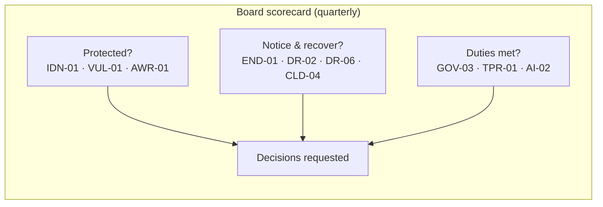
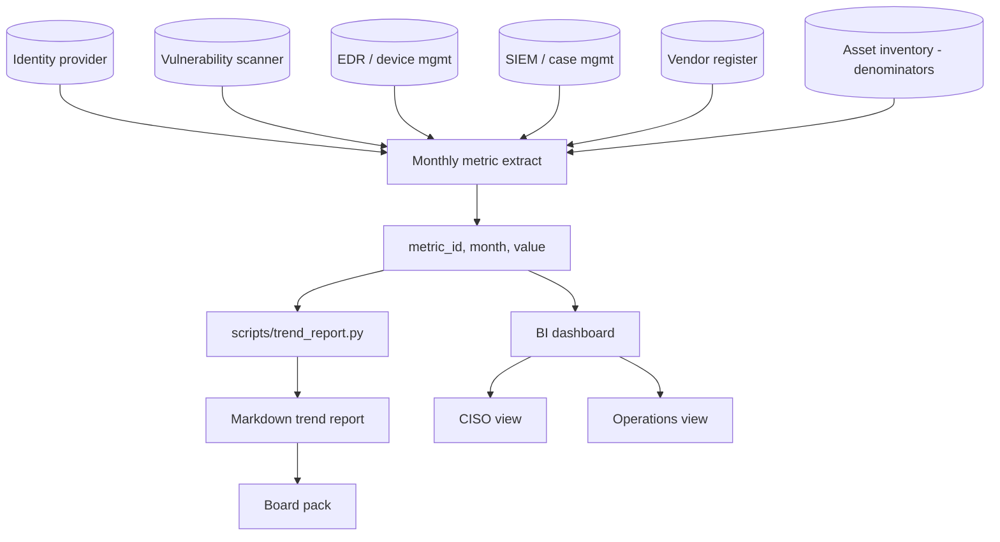
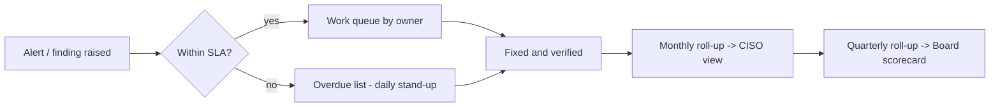

# Dashboard wireframes

Three views of the same library, one per audience. The wireframes show layout and which metrics go where; they are
deliberately tool-agnostic (build them in a BI tool, a SIEM dashboard, a spreadsheet or a static page). Metric IDs refer
to [`catalogue.md`](catalogue.md). Sparklines can be produced with `scripts/trend_report.py`.

Design rules shared by all three:

* One screen, no scrolling for the headline. Detail is one click away, never on the same page.
* Colour means *status against target* (green / amber / red), never *category*.
* Every tile shows value, target and 12-month trend. A number without context is noise.
* Monthly metrics refresh monthly; do not put a quarterly metric on a weekly dashboard.

## 1. Board view (quarterly, one page)

Audience: directors and executive committee. Ten metrics, three groups, a decisions box. See
[`board-pack.md`](board-pack.md) for the narrative behind each tile.

```
+------------------------------------------------------------------------------------------+
|  SECURITY SCORECARD  -  Q3 2026                      Overall: 7 green  2 amber  1 red     |
+------------------------------+------------------------------+----------------------------+
|  ARE WE PROTECTED?           |  WOULD WE NOTICE & RECOVER?  |  ARE WE MEETING OUR DUTIES?|
+------------------------------+------------------------------+----------------------------+
| IDN-01 MFA coverage          | END-01 EDR coverage          | GOV-03 Control coverage    |
|   99.1 %   target 99 %   G   |   98.6 %   target 98 %   G   |   82 %    target 85 %   A  |
|   ▁▂▃▄▅▆▇▇████               |   ▁▁▃▄▄▆▆▇▇███               |   ▁▁▂▂▃▃▄▄▅▆▆▆             |
+------------------------------+------------------------------+----------------------------+
| VUL-01 Critical vulns in SLA | DR-02 Time to contain        | TPR-01 Tier 1 vendors      |
|   93 %     target 90 %   G   |   3.6 h    target 4 h    G   |   100 %   target 100 %  G  |
|   ▁▁▂▁▄▅▆▅▇███               |   █▇▇▅▄▃▄▂▂▁▁▁               |   ▁▁▂▂▄▄▄▆▆▆██             |
+------------------------------+------------------------------+----------------------------+
| AWR-01 Phishing click rate   | DR-06 Incidents by severity  | AI-02 AI impact assessments|
|   5.1 %    target 5 %    A   |   C 0  H 1  M 4  L 9     G   |   60 %    target 100 %  R  |
|   █▇▆▅▅▄▃▃▂▁▁▁               |   (bars per month)           |   ▁▁▁▁▂▂▃▃▄▄▅▅             |
+------------------------------+------------------------------+----------------------------+
|                              | CLD-04 Restore tests         |                            |
|                              |   31 %     target 25 %   G   |                            |
+------------------------------+------------------------------+----------------------------+
|  DECISIONS REQUESTED                                                                     |
|  1. Approve the AI impact-assessment backlog plan (4 systems, owner: Head of Data, Q4).  |
|  2. Accept residual risk on the two legacy applications without MFA until decommission.  |
+------------------------------------------------------------------------------------------+
```



## 2. CISO view (monthly, programme health)

Audience: the security leader and the security steering group. Every category gets a row; leading and lagging metrics
sit side by side so a green hygiene number can be checked against outcomes. Red tiles link to the operations view.

```
+--------------------------------------------------------------------------------------------------+
| SECURITY PROGRAMME HEALTH - October 2026         Filter: [All domains v]  [12 months v]  [Export] |
+---------------------+--------------------------------------+---------------------------------------+
| Domain              | Leading (hygiene)                    | Lagging (outcomes)                    |
+---------------------+--------------------------------------+---------------------------------------+
| Governance          | GOV-01 Policy currency   96 %  G     | GOV-02 Overdue treatments   7   A     |
|                     | GOV-03 Control coverage  82 %  A     | GOV-04 Audit findings past due 1  A   |
|                     | GOV-05 Inventory complete 91 % A     |                                       |
+---------------------+--------------------------------------+---------------------------------------+
| Identity            | IDN-01 MFA all users     99.1 % G    | IDN-05 Leaver deprovisioning 18 h  G  |
|                     | IDN-02 PR-MFA admins     100 %  G    |                                       |
|                     | IDN-04 Dormant accounts  23     A    |                                       |
|                     | IDN-06 Access reviews    92 %   A    |                                       |
+---------------------+--------------------------------------+---------------------------------------+
| Vulnerability       | VUL-03 KEV on external   0      G    | VUL-01 Critical in SLA   93 %  G      |
|                     | VUL-04 Scan coverage     97 %   A    | VUL-02 MTTR critical     12 d  G      |
|                     | VUL-05 Median age H/C    26 d   G    |                                       |
+---------------------+--------------------------------------+---------------------------------------+
| Endpoint            | END-01 EDR coverage      98.6 % G    |                                       |
|                     | END-02 OS patch 30 d     94 %   A    |                                       |
|                     | END-03 Unsupported OS    4      A    |                                       |
+---------------------+--------------------------------------+---------------------------------------+
| Detection/response  | DR-04 Log coverage crit. 100 %  G    | DR-01 MTTD              19 h   G      |
|                     | DR-07 Technique coverage 73 %   A    | DR-02 MTTC              3.6 h  G      |
|                     | DR-03 Triage in SLA      96 %   G    | DR-06 Incidents  C0 H1 M4 L9   G      |
+---------------------+--------------------------------------+---------------------------------------+
| Awareness           | AWR-02 Report rate       55 %   G    | AWR-01 Click rate        5.1 % A      |
|                     | AWR-03 Training          98 %   G    | AWR-04 Repeat clickers   1.4 % G      |
+---------------------+--------------------------------------+---------------------------------------+
| Third party         | TPR-01 Tier 1 current    100 %  G    | TPR-02 Overdue reviews   2     G      |
|                     | TPR-04 Clauses present   84 %   A    | TPR-03 Findings > 90 d   1     R      |
+---------------------+--------------------------------------+---------------------------------------+
| Cloud               | CLD-01 High misconfigs   3      A    | CLD-04 Restore tests     31 %  G      |
|                     | CLD-02 Public storage    0      G    |                                       |
+---------------------+--------------------------------------+---------------------------------------+
| AI                  | AI-01 Inventoried        88 %   A    | AI-04 AI incidents       0     G      |
|                     | AI-02 Impact assessed    60 %   R    |                                       |
|                     | AI-03 Unapproved apps    6      A    |                                       |
+---------------------+--------------------------------------+---------------------------------------+
| Click any tile -> 12-month trend, owner, definition, last data refresh, link to operations queue   |
+--------------------------------------------------------------------------------------------------+
```



## 3. Operations view (weekly, work queues)

Audience: security engineering, SOC, IT operations. Not a scorecard: a list of things to do, ordered by risk, with
owners. Counts, not percentages, because people fix items, not rates.

```
+-------------------------------------------------------------------------------------------------+
| SECURITY OPERATIONS - week 44                          Refreshed: daily 06:00   Owner filter: [v] |
+--------------------------------------------+----------------------------------------------------+
| EXPOSURE (fix today)                       | HYGIENE QUEUES (fix this week)                     |
+--------------------------------------------+----------------------------------------------------+
| VUL-03 KEV on internet-facing assets    0  | END-01 Devices without healthy EDR agent      14   |
| VUL-06 Unapproved exposed services      2  |   by owner: Workplace 9 · Infra 3 · Unknown 2      |
| CLD-02 Public storage / databases       0  | END-02 Devices > 30 d behind on OS patches    61   |
| CLD-01 High cloud misconfigs (> 7 d)    3  | IDN-04 Dormant accounts to disable            23   |
|                                            | IDN-07 Non-expiring secrets                     5   |
|                                            | CLD-03 Unused owner-level cloud identities      2   |
+--------------------------------------------+----------------------------------------------------+
| DETECTION HEALTH                           | VULNERABILITY BACKLOG                              |
+--------------------------------------------+----------------------------------------------------+
| DR-04 Critical assets not logging       0  | Open critical  12  (oldest 21 d)  SLA due this wk 4|
| DR-03 Alerts past triage SLA (7 d)      3  | Open high      87  (median age 26 d)               |
| DR-05 False-positive rate (7 d)      54 %  | Risk-accepted  9   (3 expire this month)           |
| Top noisy rules: [rule A] [rule B]         | By platform: Linux 41 · Windows 33 · Cloud 25      |
+--------------------------------------------+----------------------------------------------------+
| OVERDUE ITEMS BY OWNER                                                                          |
| Infra 11 | Workplace 9 | Cloud 5 | AppDev 4 | GRC 2 | Unassigned 2  -> every item has a ticket   |
+-------------------------------------------------------------------------------------------------+
```



## 4. Mapping between views

| Metric | Board | CISO | Ops | Note |
|--------|:-----:|:----:|:---:|------|
| IDN-01 MFA coverage | rate | rate + trend | list of exceptions | Same source, three altitudes |
| VUL-01 Critical in SLA | rate | rate per platform | backlog by owner and age | Ops sees items, not percentages |
| END-01 EDR coverage | rate | rate + trend | devices without agent | Denominator from inventory, not EDR |
| DR-02 Time to contain | mean | mean, median, max | per-incident timeline | Board sees one number, ops sees the slowest case |
| DR-06 Incidents | by severity | by severity and category | open cases | Severity definitions must be written down |
| TPR-01 Tier 1 current | rate | rate + overdue list | assessment queue | Feeds from the vendor-risk-assessment-template workbook |
| AI-02 Impact assessed | rate | rate + backlog | systems awaiting assessment | Often red in year one; show the plan |

## 5. Anti-patterns

* **The wall of gauges.** Forty dials, no decisions. Use the audience filter in the library: a view has at most
  the metrics tagged for that audience.
* **Category colours.** Blue for identity, orange for cloud: colour should answer "is it OK?", nothing else.
* **Counts without denominators on executive views.** "14 unpatched servers" needs "of 420".
* **Percentages on operations views.** "96 % patched" does not tell an engineer which 17 machines to fix.
* **Vanity totals.** Blocked emails, scanned hosts, events per second: they measure activity, not risk.
* **Silent definition changes.** Any redefinition shows as a break in the trend line with a footnote.
